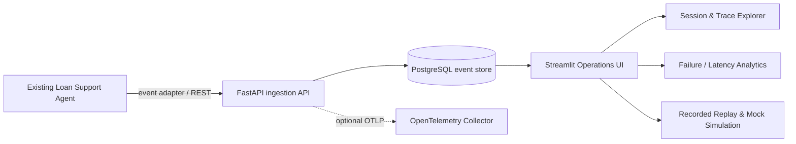

# Banking AI Agent Observability & Replay Platform

A runnable hackathon demo for operating an existing Loan Support AI Agent. It captures synthetic agent/tool events, persists them in PostgreSQL, visualizes them in Streamlit/Plotly, supports historical recorded replay, and runs safe mock simulations. It does **not** implement the loan agent or call real banking systems.

## Architecture



## Prerequisites

- Docker Desktop or Docker Engine + Docker Compose v2
- Git
- Optional: Python 3.12 for local development
- No cloud credentials or real banking data required

## Start the working demo

```bash
cp .env.example .env
# Edit POSTGRES_PASSWORD before sharing this environment
docker compose up --build -d
# Load synthetic sessions
docker compose --profile seed run --rm seed
```

Open:
- Streamlit dashboard: http://localhost:8501
- FastAPI Swagger UI: http://localhost:8000/docs
- Health: http://localhost:8000/health

To stop: `docker compose down`. To remove the local demo database too: `docker compose down -v` (destructive).

## Demo walkthrough (5–8 minutes)

1. Open **Executive Overview** and review sessions, traces, failure rate, and latency.
2. Open **Session Explorer** and select a synthetic session.
3. Inspect the trace timeline and event attributes to locate the failing tool.
4. Open **Failure Analysis** and review failed APIs/categories.
5. Open **Replay & Comparison** and select a trace. Recorded replay is read-only reconstruction; it does not call any agent/API.
6. Select `kyc_timeout` or `risk_api_error` and click **Run safe mock simulation**. Compare the synthetic result with the historical trace.
7. Open **Quality & Latency** to compare failure rate by agent version and average latency by tool.

## API examples

Health:
```bash
curl http://localhost:8000/health
```

Ingest one synthetic event:
```bash
curl -X POST http://localhost:8000/api/v1/events \
  -H 'Content-Type: application/json' \
  -d '{"event_id":"demo-event-001","session_id":"demo-session-001","trace_id":"demo-trace-001","span_id":"span-root","event_type":"user_request","status":"success","duration_ms":12,"request_text":"What is my loan status?","attributes":{"source":"manual-demo","synthetic":true}}'
```

Read trace and recorded replay:
```bash
curl http://localhost:8000/api/v1/traces/demo-trace-001
curl http://localhost:8000/api/v1/traces/demo-trace-001/replay
```

Run mock simulation:
```bash
curl -X POST http://localhost:8000/api/v1/replay/simulate \
  -H 'Content-Type: application/json' -d '{"scenario":"kyc_timeout"}'
```

## API surface

- `GET /health`
- `POST /api/v1/events`
- `POST /api/v1/traces/batch`
- `GET /api/v1/sessions`
- `GET /api/v1/sessions/{session_id}`
- `GET /api/v1/traces/{trace_id}`
- `GET /api/v1/traces/{trace_id}/timeline`
- `GET /api/v1/traces/{trace_id}/replay`
- `POST /api/v1/replay/simulate`
- `GET /api/v1/metrics/overview`
- `GET /api/v1/metrics/failures`
- `GET /api/v1/metrics/latency`
- `GET /api/v1/quality/trends`

## Event integration contract

The existing agent should emit one event per meaningful step: request received, planning summary (if allowed), tool call start/end, tool result, validation, and final response. Use stable `session_id`, `trace_id`, `span_id`, and unique `event_id`. Batch up to 500 events. Send sanitized metadata and avoid raw PII/secrets. The demo ingestion API redacts common sensitive field names in attributes and bearer tokens in strings; production systems need organization-specific redaction, DLP, encryption, access controls, and security review.

## Local Python development

Use Python 3.12 and a reachable PostgreSQL instance. Set `DATABASE_URL` before starting the app.

```bash
python -m venv .venv
# Windows PowerShell: .venv\Scripts\Activate.ps1
# macOS/Linux: source .venv/bin/activate
pip install -r requirements.txt
pytest -q
uvicorn backend.main:app --reload
# In another terminal: streamlit run frontend/app.py
```

## OpenTelemetry

The backend dependencies include OpenTelemetry API/SDK, FastAPI instrumentation, and OTLP HTTP exporter. The API is structured so service instrumentation can be configured in deployment; configure an OTLP collector endpoint using `OTEL_EXPORTER_OTLP_ENDPOINT` and add the organization's approved collector/export pipeline before production. Persisted agent spans/events are a separate data model from telemetry emitted by the observability service itself.

## Publish to GitHub

Create an empty repository in your GitHub account named `banking-agent-observability-replay`, then from this directory:

```bash
git init
git add .
git commit -m "Build banking agent observability and replay platform"
git branch -M main
git remote add origin https://github.com/<YOUR_GITHUB_USERNAME>/banking-agent-observability-replay.git
git push -u origin main
```

The included GitHub Actions workflow installs dependencies and runs the unit tests on pushes and pull requests.

## Important limitations / production backlog

This is a local synthetic-data hackathon starter, not a production banking platform. Before real workloads: add SSO/OIDC and RBAC, database TLS and least-privilege credentials, encryption/key management, tenant isolation, immutable audit logging, retention/deletion policy, robust PII/secret redaction and DLP, payload size limits, rate limiting, pagination at DB query level, migration management, OTLP exporter wiring and collector deployment, service dashboards/alerts, signed agent identity, quality evaluation integrations, replay authorization, and security/compliance review. Never replay side-effecting operations against production.
